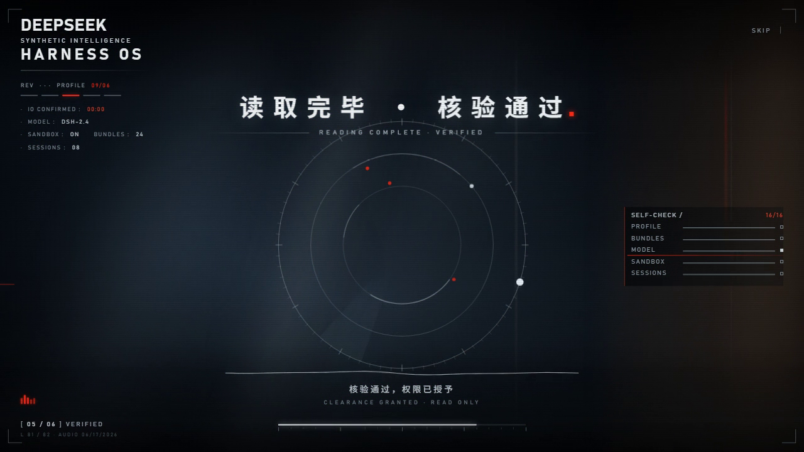

# DSH Startup Screen · 星舰开机动画

给 [DeepSeek Harness](https://github.com/deepseek-ai) 桌面端用的 38 秒科幻 HUD 启动动画：
鲸标浮现 → 环境光墙与 HUD 机框点亮 → 六步分镜（访问许可 / 身份确认 / 接收请求 / 读取权限 / 核验通过 / 会话建立）
→ 已开源 · MIT → 品牌尾板淡出。



- **规格**：1280×720 · 30fps · 38.4s · H.264 + AAC 立体声
- **纯 CSS + 原生 JS**：无框架、无构建步骤、无外部资源，单文件离线可跑
- **确定性时间轴**：所有随机（噪点、乱码解码、抖动）都由时间 `t` 决定，可在任意时刻定格重绘
- **装进 DSH 后**：每次启动软件自动全屏播放，`ESC` / 点击跳过

## 直接看

| 方式 | 说明 |
| --- | --- |
| [`dist/startup.mp4`](dist/startup.mp4) | 成片，10 MB |
| [`dist/startup-anim.html`](dist/startup-anim.html) | 网页版，双击用浏览器打开 |

网页版快捷键：`空格` / `Enter` / 点击 = 下一步，`ESC` = 跳到结尾，`R` = 重播，
`?t=22.5` 定格到第 22.5 秒，`?still=1` 只渲染首帧。

## 装进 DSH（开机自动播放）

```powershell
powershell -ExecutionPolicy Bypass -File scripts/install.ps1
```

脚本会：把本仓库复制到 `%USERPROFILE%\.dsh\profiles\desktop\node_modules\dsh-startup-screen\`，
并在该 profile 的 `cordis.patch.yml` 末尾追加一行插件注册（原文件先备份成 `.bak-<时间戳>`）。

装完 **完全退出 DeepSeek Harness（含托盘）再打开**，页面加载时就会先播这段动画。

```powershell
# 卸载（删目录 + 摘掉注册行，同样先备份）
powershell -ExecutionPolicy Bypass -File scripts/install.ps1 -Uninstall
```

### 手动安装

1. 把整个目录复制到 `%USERPROFILE%\.dsh\profiles\desktop\node_modules\dsh-startup-screen\`
2. 在 `%USERPROFILE%\.dsh\profiles\desktop\cordis.patch.yml` 末尾追加：

   ```yaml
   - insert:
       - id: startup-screen
         name: 'dsh-startup-screen'
   ```

3. 重启 DSH

### 播放控制

| 操作 | 效果 |
| --- | --- |
| `ESC` / `空格` / 点击 | 跳过（1.2 秒后生效，防误触） |
| 首次点击 | 浏览器默认禁止自动出声，右下角提示"点击任意处开启声音"，点一下即有配乐 |
| 地址栏加 `?startup=1` | 强制重播，不重启也能再看一遍 |

每个浏览器会话只播一次：刷新不重播，重启软件重播。

## 分镜

| 时间 | 画面 |
| --- | --- |
| 0.0 – 0.8s | 通电，纯黑 |
| 0.8 – 4.9s | 鲸标 + 深度求索 / DEEPSEEK 浮现、呼吸、溶解 |
| 4.5 – 7.2s | 环境光墙 / 体积光 / 胶片颗粒淡入，HUD 机框依次点亮 |
| 7.2s | 01/06 需要访问许可 `ACCESS PERMISSION REQUIRED` |
| 11.7s | 02/06 身份资料确认 `IDENTITY CONFIRMATION` |
| 15.8s | 03/06 接收访问需求 `ACCESS REQUEST RECEIVED` |
| 19.8s | 04/06 读取权限 `READING PERMISSION SCOPE`（环形进度 + 16 模块扫描条） |
| 24.1s | 05/06 读取完毕 · 核验通过 `READING COMPLETE · VERIFIED`（雷达环） |
| 28.9s | 06/06 会话已建立 `SESSION ESTABLISHED` |
| 31.3s | 已开源 · MIT |
| 34.9 – 38.4s | 品牌尾板（HUD 整体淡出），黑场收尾 |

每次切镜有约 0.3 秒的 RGB 通道分离 + 横向切片 + 白闪；标题用日文假名/随机字形"解码"出现。

## 自定义

| 想改 | 改哪里 |
| --- | --- |
| 文案 | `dist/startup-anim.html` 里的 `TITLES`（六个大标题）、`STEP_CAP`（底部中英说明） |
| 时序 | 同文件里的 `TL`（各步骤起止与 `mit` / `end` 时刻） |
| 链接 | 同文件 `.url` 那一行（默认 `github.com/OWNER/dsh-startup-screen`） |
| 配乐 | 直接替换 `dist/score.mp3` |
| 标志 | 同文件里所有 `viewBox="0 0 50 50"` 的 `<path d="...">` |

改完网页版刷新即可；要让插件也同步，重新内嵌一次资源：

```powershell
python build.py          # 读 dist/startup-anim.html + dist/score.mp3，重写 dsh/client.js
```

然后重复一遍安装脚本（或直接覆盖 `node_modules\dsh-startup-screen\dsh\client.js`），重启 DSH。

## 实现说明

- 动画是一个 1280×720 的 Stage，`renderAt(t)` 是纯函数式重绘：任何一帧只取决于 `t`，
  所以能逐帧导出视频，也能随时定格。
- 插件把整页动画以 base64 塞进同源 iframe，样式与 id 完全隔离，不会污染宿主 DOM。
- 音轨由父框架持有：浏览器自动播放策略拦截时，改成第一次用户手势后播放。
- `sessionStorage` 记录"本会话已播"，避免刷新/HMR 时重复弹出。

## 许可

[MIT](LICENSE)

## 声明

- 本项目**不是** DeepSeek 官方项目。"DeepSeek"、"深度求索"、鲸标图形等品牌元素归其权利人所有，
  它们出现在开机画面里仅用于复现桌面端的观感；若你的场景不合适，按上面"自定义"一节删掉 SVG 路径即可。
- 音轨是仓库自制的合成环境音（`dist/score.mp3`），未使用任何第三方音频素材。
  想换成自己的曲子，直接替换该文件并重新内嵌。
- 视觉语言参考了公开流传的科幻开机动画形式（HUD 分镜、乱码解码、RGB 撕裂转场），
  未复制任何他人的素材文件。

## English

A 38-second sci-fi HUD boot animation for the DeepSeek Harness desktop UI — DeepSeek mark,
volumetric light, film grain, six glitch-cut "permission" screens, MIT tail card.

```powershell
powershell -ExecutionPolicy Bypass -File scripts/install.ps1   # install into the DSH desktop profile
powershell -ExecutionPolicy Bypass -File scripts/install.ps1 -Uninstall
```

Fully quit and relaunch DeepSeek Harness to see it. `ESC` / click skips.
Open `dist/startup-anim.html` to watch it in a browser; `dist/startup.mp4` is the rendered cut.
MIT licensed. Not affiliated with DeepSeek; brand marks belong to their owners.
